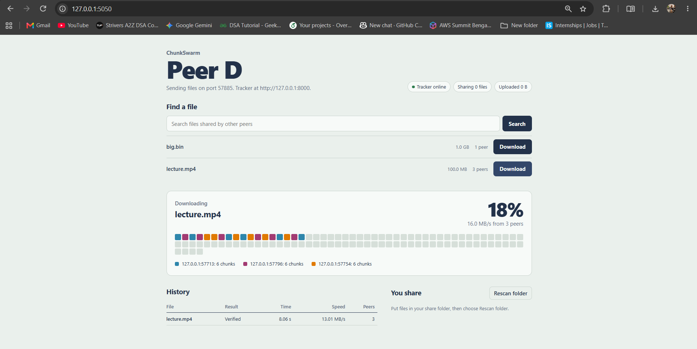
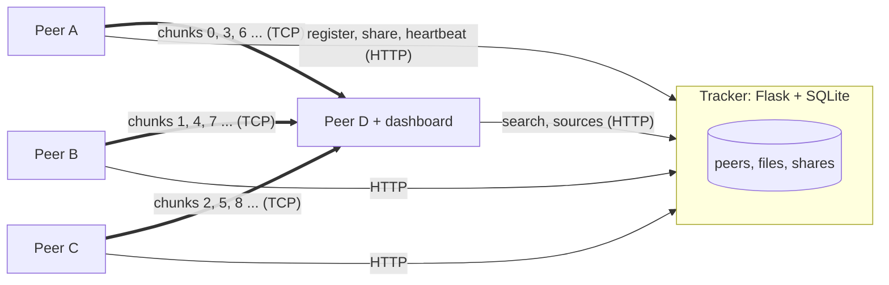
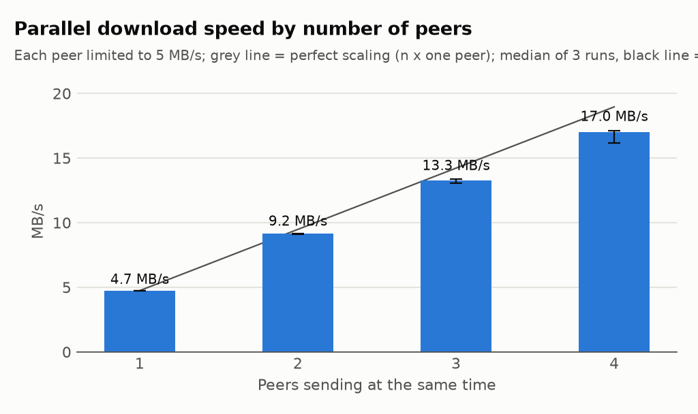

# ChunkSwarm

[](https://github.com/darshita2110/ChunkSwarm/actions/workflows/tests.yml)

**Hybrid peer-to-peer file sharing over raw TCP sockets.** A small tracker tells peers who has which file; the file itself moves directly between peers, in 1 MiB chunks, downloaded from several peers at once, with every chunk checked against a SHA-256 fingerprint.



- **Own binary protocol** over TCP: a 14-byte length-prefixed frame, JSON control header, raw file bytes.
- **Parallel downloads** from many peers through a shared work queue: **3.6x faster with 4 peers** than with 1 (measured below).
- **Verified and self-healing**: a peer that sends a tampered chunk, errors or disconnects is dropped, and its chunks are fetched from the others.
- **Resume**: an interrupted download continues where it stopped; finished chunks are re-checked, never trusted blindly.
- **Hardened**: path traversal, forged manifests, oversized messages, SQL injection, CSRF, DNS rebinding and XSS are all blocked, each one by a test.
- **121 automated tests**, run by GitHub Actions on Linux and Windows.

## How it works



1. **Register.** Each peer starts a TCP chunk server, registers with the tracker and gets a secret token. It sends a heartbeat every 10 s; a peer silent for 30 s is removed, together with its address.
2. **Share.** For each file the peer builds a **manifest**: the file's ID is the SHA-256 of its content, plus one SHA-256 per 1 MiB chunk. Identical files on different peers get the same ID automatically.
3. **Find.** A downloader searches the tracker by name and asks for the file's trusted manifest and the list of peers that have it.
4. **Download.** One worker thread per peer pulls chunk numbers from a shared queue, requests each chunk over its own TCP connection, checks the chunk's hash, and writes it at its offset in a `.part` file. Faster peers simply take more chunks.
5. **Finish.** The whole file is hashed once more; only if it equals the file ID is it renamed to its real name.

### Wire protocol

Every message is one frame; integers are big-endian (network byte order).

| Field | Size | Meaning |
| --- | --- | --- |
| version | 1 byte | protocol version, currently 1 |
| type | 1 byte | PING, PONG, GET_MANIFEST, MANIFEST, GET_CHUNK, CHUNK_DATA, ERROR |
| header length | 4 bytes | size of the JSON header (at most 16 KiB) |
| payload length | 8 bytes | size of the raw data (at most the chunk size) |
| header | variable | JSON object, e.g. `{"file_id": "6b55…", "index": 3}` |
| payload | variable | raw chunk bytes (no Base64) |

TCP is a byte stream, so one `send` can arrive as several `recv`s and two sends can arrive as one. The length prefix tells the receiver exactly where each message ends. Lengths are checked **before** any memory is allocated, so a forged "1 TB" header costs the receiver only 14 bytes.

## Security

| Threat | Defence | Test |
| --- | --- | --- |
| Path traversal (`../../etc/passwd`) | Peers request files by 64-hex ID only; only files inside the share folder (after resolving shortcuts) can be shared; incoming names are sanitised | `test_unknown_or_path_like_file_ids_rejected`, `test_cannot_share_files_outside_the_share_folder`, `test_safe_filename` |
| Tampered or corrupted chunk | Per-chunk SHA-256 against the tracker's manifest, plus a whole-file check; the bad peer is dropped | `test_evil_peer_caught_and_chunk_fetched_from_honest_peer`, `test_evil_peer_is_dropped_and_its_chunk_refetched` |
| Forged manifest | The tracker rejects a manifest that conflicts with the one already known for that file ID | `test_conflicting_manifest_rejected` |
| Oversized messages, connection floods, silent clients | Frame size limits checked before reading, a cap on simultaneous connections, idle timeouts, a request rate limit | `test_bad_prefix_rejected_before_allocating`, `test_connection_limit`, `test_silent_connections_are_dropped`, `test_rate_limit` |
| Fake peer addresses | The tracker records the address of the actual TCP connection, never one sent in the request | `test_host_comes_from_connection_not_body` |
| Stolen tracker database | Only SHA-256 hashes of peer tokens are stored; tokens are compared in constant time | `test_token_is_not_stored_in_plaintext` |
| SQL injection | Parameterised queries; `LIKE` wildcards escaped | `test_search_escapes_like_wildcards` |
| CSRF against the dashboard | Every POST needs a per-session secret token header | `test_post_without_token_is_refused` |
| DNS rebinding | Requests whose `Host` is not 127.0.0.1 or localhost are refused | `test_foreign_host_header_is_refused` |
| XSS through file names | Names sanitised by the tracker; the page inserts text only with `textContent`; strict Content-Security-Policy | `test_evil_file_name_is_only_ever_data` |
| Lost error replies on Windows | Graceful close (FIN, then drain) instead of a reset | `test_garbage_bytes_get_an_error_and_disconnect` |

**Privacy:** the tracker keeps a peer's IP address only while the peer is online and never shows addresses on its public health endpoint. Databases, downloads and shared folders are excluded from Git.

## Benchmarks

Measured with [`scripts/bench.py`](scripts/bench.py) on Windows 11 (12 CPU threads, Python 3.14), over real TCP on 127.0.0.1, every chunk SHA-256 verified. Each configuration ran 3 times; the median is shown, the range in brackets. Full data: [`bench/summary.md`](bench/summary.md), [`bench/results.csv`](bench/results.csv).



| Peers (each limited to 5 MB/s) | 1 | 2 | 3 | 4 |
| --- | ---: | ---: | ---: | ---: |
| Speed (MB/s) | 4.7 | 9.2 | 13.3 | 17.0 |
| Speed-up | 1.0x | 1.9x | 2.8x | **3.6x** |

Each peer is limited to 5 MB/s to model a home upload link; on one machine without a limit, every peer would share the same CPU and disk, and parallelism could not show. Scaling is close to linear. The gap to a perfect 4x grows with more peers: all workers share one CPU for hashing, and writing each chunk and saving resume state happen one at a time under a single lock.

| Experiment | Result | Reading |
| --- | --- | --- |
| [Chunk size](bench/chunk_size.png), 1 peer, no limit | 256 KiB: 44.0 MB/s, **1 MiB: 68.6 MB/s**, 4 MiB: 39.4 MB/s | 1 MiB is the best of the three. Small chunks pay a request round trip and a state-file write per chunk. A likely cause for large chunks is that each request waits for the whole chunk, then hashes and writes it before asking for the next, so the connection sits idle for longer. Not yet profiled. |
| [File size](bench/file_size.png), 1 peer, no limit | 10 MB: 48.4 MB/s, 50 MB: 81.0, 100 MB: 70.3, 200 MB: 73.4 | Throughput is steady from 50 MB up; small files are dominated by fixed costs (connecting, the final whole-file hash, the rename). |
| [Failover](bench/recovery.png), 3 limited peers, one dies halfway | 4.72 s without failure, 5.74 s with one (median) | Losing a third of the peers mid-download cost about 1 second; the remaining peers finished its chunks and the file was still verified. |

Unlimited single-peer results measure this laptop (CPU, disk, antivirus scanning new files) rather than the network, and vary more between runs.

## Run it

Requires Python 3.10+.

```bash
git clone https://github.com/darshita2110/ChunkSwarm.git
cd ChunkSwarm
python -m venv .venv
.venv\Scripts\activate            # macOS/Linux: source .venv/bin/activate
pip install -e ".[dev]"
pytest                             # 121 tests
```

Start a tracker, one peer that shares a file, and one peer with the dashboard, each in its own terminal:

```bash
chunkswarm-tracker --port 8000
chunkswarm-peer --share-dir shared_a --download-dir dl_a --name A
chunkswarm-peer --share-dir shared_d --download-dir dl_d --name D --ui-port 5050
```

Put any file in `shared_a` before starting peer A, then open http://127.0.0.1:5050, search and download. Each peer also has a terminal interface (`search`, `get 1`, `files`, `stats`, `quit`). Useful options: `--upload-limit 5` (MB/s, to imitate a slower link), `--host <LAN IP>` and `--tracker http://<tracker LAN IP>:8000` for running across several computers on the same network.

To reproduce the benchmarks: `pip install -e ".[bench]"`, then `python scripts/bench.py` (about 5 minutes, or `--quick` for a 20-second check).

## Project layout

```
src/chunkswarm/
  protocol.py      framed binary messages over TCP, size limits
  manifest.py      chunking, SHA-256 manifests, safe file names
  peer_server.py   threaded TCP server that sends chunks
  downloader.py    parallel, verified, resumable chunk downloader
  tracker.py       Flask + SQLite tracker: registration, search, heartbeats
  peer.py          a full peer: server + tracker client + downloader + terminal UI
  dashboard.py     local web dashboard (static/ holds its page)
tests/             121 tests: protocol edge cases, attacks, failover, resume, end to end
scripts/bench.py   benchmark runner that writes bench/
playground/        first socket experiments (echo server, framing checks)
```

## Limitations and next steps

- Traffic is not encrypted yet. The next step is TLS between peers with each peer's certificate fingerprint published by the tracker (certificate pinning).
- SHA-256 proves a file is intact, not who published it. Signed manifests would add authenticity.
- Works on a local network; connecting peers behind different home routers would need NAT traversal.
- One tracker is a single point of failure; a DHT could replace it.
- The downloader writes chunks under one lock; a dedicated writer thread could narrow the gap to perfect scaling.

## License

MIT, see [LICENSE](LICENSE).